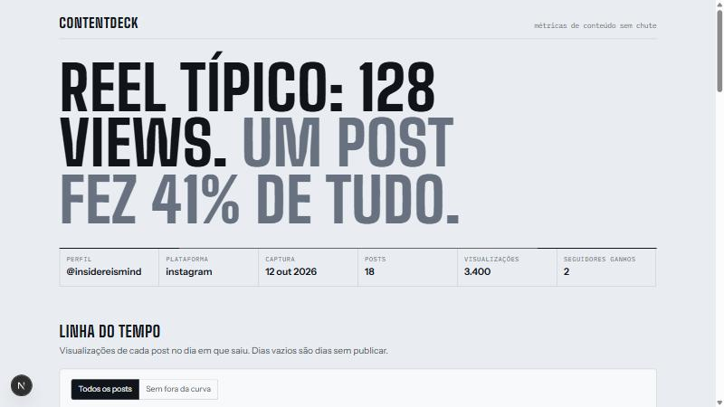
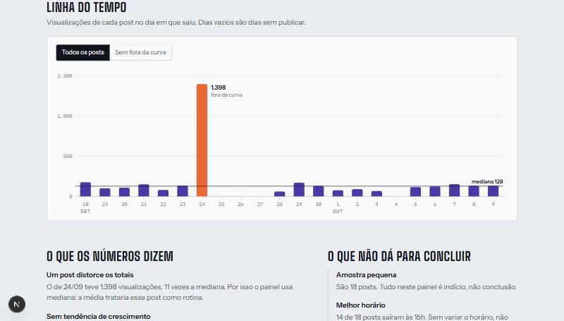

# ContentDeck

Métricas de conteúdo sem chute: carrega exports do Instagram num Postgres, guarda a evolução de cada post e serve leituras prontas por uma API. Construído para rodar experimentos de publicação num perfil real, [@insidereismind](https://www.instagram.com/insidereismind/).

**No ar:** [contentdeck-nine.vercel.app](https://contentdeck-nine.vercel.app) · API e documentação em [/api/docs](https://contentdeck-nine.vercel.app/api/docs)





## Por que existe

O Instagram mostra números por post, mas não responde "postar à noite rende mais?" nem "esse vídeo foi bom ou só teve mais tempo no ar?". O ContentDeck guarda cada export como uma captura datada, deixa anotar o que foi testado em cada post e compara grupos com mediana, porque um único post viral distorce qualquer média.

Primeiro export real (18 Reels, 22 dias): mediana de 128 visualizações por post, um post fora da curva com 41% do total, 2 seguidores ganhos. É o ponto de partida dos experimentos.

## API

`uvicorn api:app --reload`, documentação interativa em `http://localhost:8000/docs`.

| Rota | Devolve |
|---|---|
| `GET /profiles/{handle}/summary` | totais, medianas e peso do maior post |
| `GET /profiles/{handle}/posts` | posts ordenáveis por data, views ou engajamento; filtro por tema |
| `GET /posts/{id}/history` | todas as capturas de um post: a curva de crescimento |
| `GET /profiles/{handle}/themes` | comparação por tema anotado |
| `GET /profiles/{handle}/weekly` | evolução por semana de publicação |
| `GET /profiles/{handle}/insights` | posts fora da curva, seguidores por mil de alcance, composição das interações, desempenho por duração |
| `GET /profiles/{handle}/experiments` | cada experimento com o desempenho por variante |

A rota de experimentos descreve as variantes e não declara vencedor: com poucos posts por grupo a diferença costuma ser ruído.

## Painel

Next.js em `web/`. Lê a API no servidor e abre com uma frase, não com uma grade de números: o que é um post típico e quanto um único post pesa no total.

- **Página inteira no HTML.** O servidor espera os dados e entrega o relatório pronto, sem depender de JavaScript para o mostrar; o link tem cartão de prévia próprio (`opengraph-image`).
- **Linha do tempo.** Um dia por coluna, com os dias sem publicar à vista. O post fora da curva vem noutra cor e rotulado; um botão tira-o da escala para ler os demais.
- **O que os números dizem / o que não dá para concluir.** Frases geradas a partir dos dados, em `web/lib/findings.ts`. A segunda coluna é a mais importante: avisa quando a amostra é pequena, quando quase todos os posts saíram à mesma hora ou com as mesmas hashtags.
- **Medianas por semana, duração e tema**, experimentos e a tabela completa, ordenável.

Gráficos em SVG escritos à mão, sem biblioteca. As duas cores de dados foram validadas para daltonismo e contraste nos temas claro e escuro. Cada valor do gráfico também está na tabela.

```bash
cd web
npm install
cp .env.example .env.local     # API_URL e PROFILE_HANDLE
npm run dev                    # http://localhost:3000, com a API a correr na 8000
```

## Deploy

Tudo em planos gratuitos, num único projeto da Vercel:

```
contentdeck-nine.vercel.app
├── /api/*  →  serviço "api"  (FastAPI, função Python)
└── /*      →  serviço "web"  (Next.js)          base: Postgres na Neon
```

- `vercel.json` declara os dois serviços. O painel chama a API por uma ligação privada entre serviços (`API_INTERNAL_URL`), sem passar pela internet pública.
- O prefixo `/api` é retirado antes de chegar ao FastAPI; `root_path` mantém a documentação a funcionar em `/api/docs`.
- A base foi criada pela integração da Neon, que injeta `DATABASE_URL` no projeto. `db.py` normaliza o URL para o driver instalado e, em serverless, abre e fecha a ligação a cada pedido.
- Cada push em `main` gera um deploy.

Para atualizar os dados publicados depois de um novo export:

```bash
python prod.py ingest.py
python prod.py annotate.py load
```

## Como rodar

Requer Python 3.13 e PostgreSQL local, com uma base de dados já criada.

```bash
python -m venv .venv
source .venv/Scripts/activate        # Git Bash no Windows; no Linux/macOS: .venv/bin/activate
pip install -r requirements.txt
cp .env.example .env                 # ajuste utilizador, senha e base
python migrate.py                    # cria as tabelas
python ingest.py data/instagram_export.csv instagram exemplo
uvicorn api:app --reload
```

Depois abra `http://localhost:8000/profiles/exemplo/summary`.

## Rotina semanal

1. Exportar os posts no Meta Business Suite e guardar o CSV em `data/`, com o nome original.
2. `python ingest.py` carrega o export mais recente. A data da captura sai do nome do ficheiro.
3. `python annotate.py template`, preencher `data/annotations.csv`, `python annotate.py load`.

Carregar o mesmo export duas vezes atualiza, não duplica.

## Modelo de dados

```
profiles ─< posts ─< metrics            uma linha de metrics por post por dia de captura
              └──< experiment_posts >── experiments
```

- **Capturas datadas.** As métricas do export são acumuladas, então cada carga é uma fotografia (`captured_on`), única por post e dia.
- **`latest_metrics`.** Visão com a captura mais recente de cada post; as rotas leem daqui para não somar capturas antigas.
- **Anotações.** Tema, gancho, conjunto de hashtags e chamada para ação ficam em `posts`, preenchidos à mão: o export não diz o que foi testado.
- **Migrações.** `schema.SQL` é a versão 001; `migrate.py` aplica cada ficheiro de `migrations/` uma única vez, dentro de uma transação.

## Estrutura

| Ficheiro | Função |
|---|---|
| `schema.SQL`, `migrations/`, `migrate.py` | schema versionado |
| `ingest.py` | lê o CSV, normaliza e grava posts e métricas |
| `annotate.py` | anotações manuais e ligação a experimentos |
| `analyze.py` | análise exploratória de um export, no terminal |
| `db.py`, `api.py` | API em FastAPI |
| `vercel.json`, `prod.py` | deploy dos dois serviços; scripts contra a base publicada |
| `web/` | painel em Next.js (App Router, TypeScript, CSS puro) |
| `tests/` | 25 testes, numa base própria criada e apagada a cada execução |

## Testes

```bash
pytest tests
```

Os testes criam `contentdeck_test`, aplicam as migrações, carregam o CSV de exemplo e apagam a base no fim. A base real não é tocada. Correm também no GitHub Actions, com Postgres 17.

## Limitações conhecidas

- O caminho do TikTok em `ingest.py` nunca foi testado com um export real.
- `posts.external_id` é único no banco inteiro, não por perfil.
- Sem dados de retenção (tempo assistido): o export usado não os traz.
- Comparar posts de idades diferentes ainda é injusto; "views nos primeiros 7 dias" depende de acumular mais capturas.
- A API é só de leitura e não tem autenticação; a carga é feita pela linha de comandos.
- O painel mostra um perfil só, definido por variável de ambiente.
- As capturas de tela acima vêm do modo de desenvolvimento.
- A base publicada e a local são independentes: a carga tem de ser feita nas duas.

## Licença

MIT.
